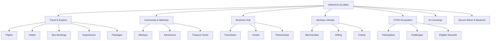

# ✦ VANHSYA GLOBAL
### DISCOVER • CONNECT • EXPERIENCE

**A new-generation travel, lifestyle, experiences, community and digital ecosystem.**

<p align="center">
  
</p>

<p align="center">
  <strong>Travel Beyond Destinations. Connect Beyond Boundaries.</strong>
</p>

---

## 🌍 About Vanhsya Global

Vanhsya Global is an ambitious digital platform designed to bring travel, adventure, people, business opportunities and meaningful experiences together in one connected ecosystem.

The vision is to create more than an ordinary travel website.

Vanhsya aims to give people a place where they can:

- Discover extraordinary destinations.
- Explore unique travel experiences.
- Book flights, hotels, buses and activities.
- Meet new people and build genuine connections.
- Participate in adventures and community events.
- Discover business and franchise opportunities.
- Explore Vanhsya-branded merchandise.
- Participate in charitable initiatives.
- Experience interactive games and challenges.
- Discover the separate VYNO digital ecosystem.
- Access an intelligent multilingual travel assistant.

**Our philosophy:**

> Life is not only about where you travel. It is about what you experience, who you meet and the memories you create.

---

# ✨ THE VANHSYA EXPERIENCE

## 01 — Explore the World

Discover destinations, hidden places, local experiences and extraordinary journeys.

Planned experiences include:

- Dubai and Abu Dhabi discoveries.
- Desert adventures.
- Mountain escapes.
- Beach and island experiences.
- Luxury stays.
- Cultural experiences.
- International travel.
- Curated holiday packages.
- Local experiences and activities.

## 02 — Travel & Bookings

A connected travel discovery and booking experience.

Planned services:

| Service | Planned functionality |
|---|---|
| Flights | Search and access real flight inventory |
| Hotels | Discover and book accommodation |
| Bus tickets | Search routes and available services |
| Experiences | Book activities and adventures |
| Packages | Explore curated holiday packages |
| Events | Reserve places at community experiences |
| Kiosks | Discover physical Vanhsya booking points |

Real prices, schedules and availability must come from configured providers or verified internal inventory.

## 03 — Meet & Connect

A community experience designed to bring people together.

Planned features:

- Coffee with strangers.
- Dinner with strangers.
- Group meetups.
- Travel companions.
- Friendship activities.
- Couples' experiences.
- Hobby communities.
- Cultural gatherings.
- Social discovery.
- Community events.

The platform should make it easy to discover activities and connect while respecting privacy, consent and personal safety.

## 04 — Adventures & Mystery Experiences

Discover experiences beyond ordinary sightseeing.

Planned categories:

- Night desert adventures.
- Mystery experiences.
- Treasure hunts.
- Escape challenges.
- Couples' adventure dates.
- Mountain exploration.
- Outdoor challenges.
- Night-time experiences.
- Special surprise adventures.

All experiences must have accurate descriptions, real operators, safety requirements, eligibility and booking conditions.

## 05 — Vanhsya Business Hub

A platform for businesses, entrepreneurs and travel operators.

Planned opportunities:

- Business partnerships.
- Local experience providers.
- Travel service operators.
- Booking kiosk applications.
- Franchise enquiries.
- Tourism collaborations.
- Business registration and profiles.

Only approved businesses and verified locations should be represented as official Vanhsya partners.

## 06 — Vanhsya Gives Back

A dedicated space for approved charity and community initiatives.

Planned areas:

- Community support.
- Clothing donations.
- Educational assistance.
- Volunteer activities.
- Seasonal campaigns.
- Social responsibility initiatives.
- Transparent campaign updates.

Only genuine campaigns and verified impact information should be published.

## 07 — Vanhsya Lifestyle

A dedicated merchandise and gifting experience.

Potential products:

- Vanhsya T-shirts.
- Hoodies.
- Caps.
- Travel accessories.
- Limited collections.
- Community merchandise.

Potential gifting experiences:

- Birthday surprises.
- Anniversary gifts.
- Special occasion experiences.
- Personalised merchandise.
- Community appreciation gifts.

Customer preferences must be optional and privacy-protected.

## 08 — VYNO Digital Ecosystem

A separate digital engagement experience.

Potential features:

- Token information.
- Wallet connection.
- Community challenges.
- Educational quizzes.
- Spin-style promotional activities.
- Scratch-card experiences.
- Referral participation.
- Reward history.
- Eligible token claims.

Actual token claims must use verified contract information, secure server-side eligibility checks and an approved distribution mechanism.

No fabricated balances, guaranteed earnings or misleading investment claims.

---

# 🎨 VISUAL IDENTITY & DESIGN SYSTEM

Vanhsya should have a distinctive premium visual identity.

### Brand direction

| Element | Design direction |
|---|---|
| Primary background | Matte black / charcoal |
| Secondary background | Deep purple |
| Accent | Champagne gold |
| Highlight | Refined lavender |
| Typography | Modern, elegant and readable |
| Photography | Cinematic, authentic and editorial |
| Interactions | Smooth, sophisticated and purposeful |
| 3D design | Immersive but performance-conscious |

### Design principles

1. Premium, not overcrowded.
2. Cinematic, not visually chaotic.
3. Modern, not generic.
4. Interactive, not distracting.
5. Consistent across every page.
6. Beautiful on mobile as well as desktop.
7. Accessible and easy to navigate.

Avoid excessive gradients, unnecessary glow effects, repeated stock images and animations that slow down the experience.

---

# 🖼️ IMAGE & MEDIA LIBRARY

Visual quality is a major part of the Vanhsya experience.

Every page should have imagery that matches its actual subject.

### Recommended project asset structure

```text
public/
└── assets/
    ├── brand/
    │   ├── vanhsya-logo.svg
    │   ├── vanhsya-wordmark.svg
    │   └── favicon.svg
    │
    ├── home/
    │   ├── hero-desktop.webp
    │   ├── hero-mobile.webp
    │   └── featured/
    │
    ├── destinations/
    │   ├── dubai/
    │   ├── abu-dhabi/
    │   ├── uae/
    │   └── international/
    │
    ├── experiences/
    │   ├── desert/
    │   ├── mountains/
    │   ├── beaches/
    │   ├── luxury/
    │   ├── culture/
    │   └── adventure/
    │
    ├── meetups/
    │   ├── coffee/
    │   ├── dinner/
    │   └── community/
    │
    ├── blueprint/
    │   ├── treasure-hunt/
    │   ├── maps/
    │   └── clues/
    │
    ├── adventures/
    │   ├── night/
    │   ├── mystery/
    │   └── couples/
    │
    ├── travel/
    │   ├── flights/
    │   ├── buses/
    │   ├── hotels/
    │   └── packages/
    │
    ├── business/
    │   ├── kiosks/
    │   ├── franchise/
    │   └── partnerships/
    │
    ├── community/
    ├── charity/
    ├── merchandise/
    ├── vyno/
    ├── icons/
    └── videos/
```

Adapt this structure to the existing framework and asset conventions. Do not move existing files without checking their references.

### Image-generation standard

All new AI-generated images should follow this creative direction:

- Highest available image-generation quality.
- 8K-quality detail where supported.
- Photorealistic environments.
- Natural human proportions.
- Realistic architecture and landscapes.
- Cinematic lighting.
- Premium editorial composition.
- Professional colour grading.
- Detailed textures and materials.
- No watermarks.
- No distorted faces or hands.
- No artificial-looking text.
- No repeated compositions.

### Image aspect ratios

| Usage | Recommended ratio |
|---|---|
| Website hero | 16:9 or wider |
| Destination cards | 3:2 |
| Experience cards | 4:5 |
| Community profiles | 1:1 |
| Vertical campaigns | 9:16 |
| README banner | 16:5 or similar wide format |

### Master AI image-generation prompt

Use this as the starting prompt for each individual image:

> Generate a premium photorealistic cinematic editorial photograph for Vanhsya Global, an international travel and lifestyle brand. Subject: [SPECIFIC DESTINATION OR EXPERIENCE]. Create an extraordinary but believable scene with realistic human subjects, natural architecture, accurate environmental details, cinematic lighting, rich atmospheric depth and professional travel-photography composition. Use elegant charcoal, deep-purple and champagne-gold visual accents where appropriate. Maintain realistic proportions, authentic details, natural skin texture and sophisticated colour grading. The result should feel like an internationally recognised luxury travel campaign. Use the highest available resolution and quality. Avoid watermarks, logos, text, distorted people, artificial-looking buildings and generic stock-photo compositions.

**Important image rules:**

- Find existing project images before replacing anything.
- Identify duplicate and near-duplicate images.
- Use different images for different experiences.
- Generate missing images individually.
- Use licensed and permitted source material.
- Keep an image inventory with file path, subject, source and licence.
- Never use concept images to imply that a real hotel, event, business or branch exists.
- Optimise images for mobile, tablet and desktop.
- Use AVIF or WebP where appropriate.
- Lazy-load images below the fold.
- Include accessible alt text.

---

# 🧭 PLATFORM ARCHITECTURE

The intended platform can be organised into these major systems:



This is a conceptual product diagram, not a statement that all integrations are already implemented.

---

# 🛠️ TECHNOLOGY & DEVELOPMENT

The technology stack must be confirmed by inspecting the actual repository.

Potential architecture:

| Layer | Responsibility |
|---|---|
| Frontend | Responsive website and interactive experience |
| Backend | Authentication, business logic and APIs |
| Database | Users, bookings, events and activity records |
| Storage | Images, videos and documents |
| Payments | Secure payment provider integration |
| Travel APIs | Flight, hotel and bus inventory |
| Blockchain | Verified VYNO network integration |
| AI | Multilingual concierge and recommendations |
| Hosting | Configured production deployment |

Do not introduce a new framework or replace the existing stack without first evaluating the project.

---

# 🔐 SECURITY & TRUST

Security is a core requirement.

- Keep API secrets on the server.
- Never expose private keys or wallet seed phrases.
- Use secure authentication and session handling.
- Validate all form submissions.
- Apply rate limits to sensitive endpoints.
- Verify payment webhooks.
- Prevent duplicate bookings and reward claims.
- Use role-based administrator permissions.
- Protect personal information.
- Provide account and privacy controls.
- Maintain appropriate audit logs.

Investment, donation collection, token distribution and other regulated activities must remain disabled until the relevant legal, operational and technical requirements are satisfied.

---

# 🌐 MULTILINGUAL EXPERIENCE

The platform should be designed for international users.

Planned languages:

- English
- Arabic
- Malayalam
- Hindi
- Tamil
- Telugu
- Kannada
- Bengali
- Urdu
- French
- Spanish
- German
- Russian
- Chinese

Planned AI concierge capabilities:

- Automatic language detection.
- User-selected language.
- Regional expressions and informal language understanding.
- Common slang recognition.
- Malayalam-English mixed conversation.
- Hindi-English mixed conversation.
- Arabic-English mixed conversation.
- Multilingual search.
- Voice interaction where supported.
- Right-to-left layouts.
- Localised dates and currencies.

Legal, safety, booking and payment information must use professionally reviewed translations.

---

# 📁 PROJECT DOCUMENTATION

Maintain project documentation in this structure:

```text
README.md
.env.example
.gitignore

docs/
├── ARCHITECTURE.md
├── ASSET-INVENTORY.md
├── IMAGE-GUIDELINES.md
├── BOOKING-INTEGRATIONS.md
├── ENVIRONMENT-VARIABLES.md
├── PRIVACY-AND-SECURITY.md
├── VYNO-INTEGRATION.md
└── DEPLOYMENT.md
```

Create these documents as they become relevant to the actual implementation.

---

# ⚙️ LOCAL DEVELOPMENT

## Requirements

- Git
- Node.js version supported by the project
- The package manager used by the project
- VS Code or another suitable editor
- Required API credentials for configured integrations

## Clone the repository

```bash
git clone <YOUR_NEW_GITHUB_REPOSITORY_URL>
cd <YOUR_PROJECT_DIRECTORY>
```

## Install dependencies

First inspect the lockfile and use the matching package manager.

For npm projects:

```bash
npm install
```

For pnpm projects:

```bash
pnpm install
```

For Yarn projects:

```bash
yarn install
```

Do not create multiple lockfiles.

## Configure environment variables

Create `.env.local` if required by the framework.

Use the exact variable names referenced in the source code.

Never commit private credentials.

## Start development

Check `package.json` for the actual scripts.

Common examples:

```bash
npm run dev
npm run build
npm run lint
npm run test
```

Do not assume a script exists until it has been checked.

---

# 🔑 ENVIRONMENT CONFIGURATION

Potential integrations may require:

| Variable | Purpose |
|---|---|
| `ADMIN_PASSCODE` | Protected administrator configuration |
| `SESSION_SECRET` | Session security |
| `APP_BASE_URL` | Application's canonical URL |
| `STRIPE_SECRET_KEY` | Server-side payment access |
| `STRIPE_WEBHOOK_SECRET` | Payment webhook verification |
| `AMADEUS_CLIENT_ID` | Flight API authentication |
| `AMADEUS_CLIENT_SECRET` | Flight API authentication |
| `HOTELBEDS_API_KEY` | Hotel provider authentication |
| `BUS_PROVIDER_API_KEY` | Bus inventory provider access |
| `VYNO_CONTRACT_ADDRESS` | Verified token contract |
| `VYNO_CHAIN_ID` | Matching blockchain network |

Confirm every variable against the actual code before configuring it.

Generate a secure session secret on macOS/Linux:

```bash
openssl rand -hex 32
```

Never place real credentials inside README.md, GitHub commits, frontend code or screenshots.

---

# 📦 GIT & GITHUB WORKFLOW

This project is intended to be maintained in a new GitHub repository.

## 1. Initialise Git

If the project is not already a Git repository:

```bash
git init -b main
```

If Git is already initialised, inspect the existing branch and working tree first.

## 2. Check files

```bash
git status
```

Ensure `.env`, `.env.local`, private credentials and generated build files are excluded.

## 3. Add the project

```bash
git add .
```

## 4. Create the first commit

```bash
git commit -m "Initial Vanhsya Global platform setup"
```

## 5. Connect the new GitHub repository

Create an empty repository on GitHub.

Then connect it:

```bash
git remote add origin <YOUR_NEW_GITHUB_REPOSITORY_URL>
```

If an `origin` remote already exists, inspect it before changing it:

```bash
git remote -v
```

## 6. Push to main

```bash
git push -u origin main
```

## 7. Future updates

After making changes:

```bash
git status
git diff --check
git add .
git commit -m "Describe your changes"
git push origin main
```

Review the diff before committing.

Never force-push to `main` to solve an ordinary merge conflict.

---

# 🚀 DEPLOYMENT

The project may be connected to a hosting provider such as Vercel.

Before deployment:

- Confirm the correct GitHub repository.
- Confirm the production branch is `main`.
- Confirm the framework and build settings.
- Configure environment variables in the deployment platform.
- Use separate development and production credentials.
- Check build logs.
- Check runtime logs.
- Test the production deployment.
- Verify all important routes.
- Test forms and authentication.
- Test payment flows in the provider's test environment.
- Confirm that no secret has been exposed.

A successful build does not prove that an external booking or payment integration is operational.

---

# ✅ DEVELOPMENT CHECKLIST

## Foundation

- [ ] New GitHub repository created.
- [ ] Project connected to Git.
- [ ] README added.
- [ ] `.gitignore` checked.
- [ ] `.env.example` created.
- [ ] Original source code preserved.
- [ ] Existing routes audited.

## Visual experience

- [ ] Brand identity established.
- [ ] Logo and favicon prepared.
- [ ] Homepage hero image created.
- [ ] Unique destination images added.
- [ ] Experience images added.
- [ ] Community images added.
- [ ] Adventure images added.
- [ ] Business and kiosk concept images added.
- [ ] Merchandise images added.
- [ ] VYNO visual identity prepared.
- [ ] Duplicate image audit completed.
- [ ] Mobile image crops checked.
- [ ] Image performance optimised.

## Platform functionality

- [ ] Travel discovery.
- [ ] Experience booking.
- [ ] Flight provider integration.
- [ ] Hotel provider integration.
- [ ] Bus provider integration.
- [ ] Secure payment integration.
- [ ] User accounts.
- [ ] Customer dashboard.
- [ ] Business Hub.
- [ ] Kiosk applications.
- [ ] Franchise enquiries.
- [ ] Community features.
- [ ] Charity information.
- [ ] Merchandise.
- [ ] Multilingual AI assistant.
- [ ] VYNO participation experience.
- [ ] Secure administration.

## Launch

- [ ] Responsive testing completed.
- [ ] Security review completed.
- [ ] Available automated tests pass.
- [ ] Production environment configured.
- [ ] GitHub push completed.
- [ ] Deployment successful.
- [ ] Production smoke tests completed.

---

# 💜 OUR VISION

Vanhsya is being built around a simple idea:

**Discover more. Connect more. Experience more.**

A place where travel becomes an experience, strangers become connections, ideas become opportunities and communities create memories.

We are building an ecosystem that brings people, places, businesses and digital experiences together.

<p align="center">
  <strong>VANHSYA GLOBAL</strong><br/>
  <em>Beyond Travel. Beyond Ordinary.</em>
</p>

---

**Project status:** Under development  
**Repository:** To be configured  
**Brand:** Vanhsya Global  
**General enquiries:** info@vanhsya.com  
**Customer support:** support@vanhsya.com

*This README describes the intended product vision. Individual features and integrations should only be marked operational after implementation, configuration and testing.*
